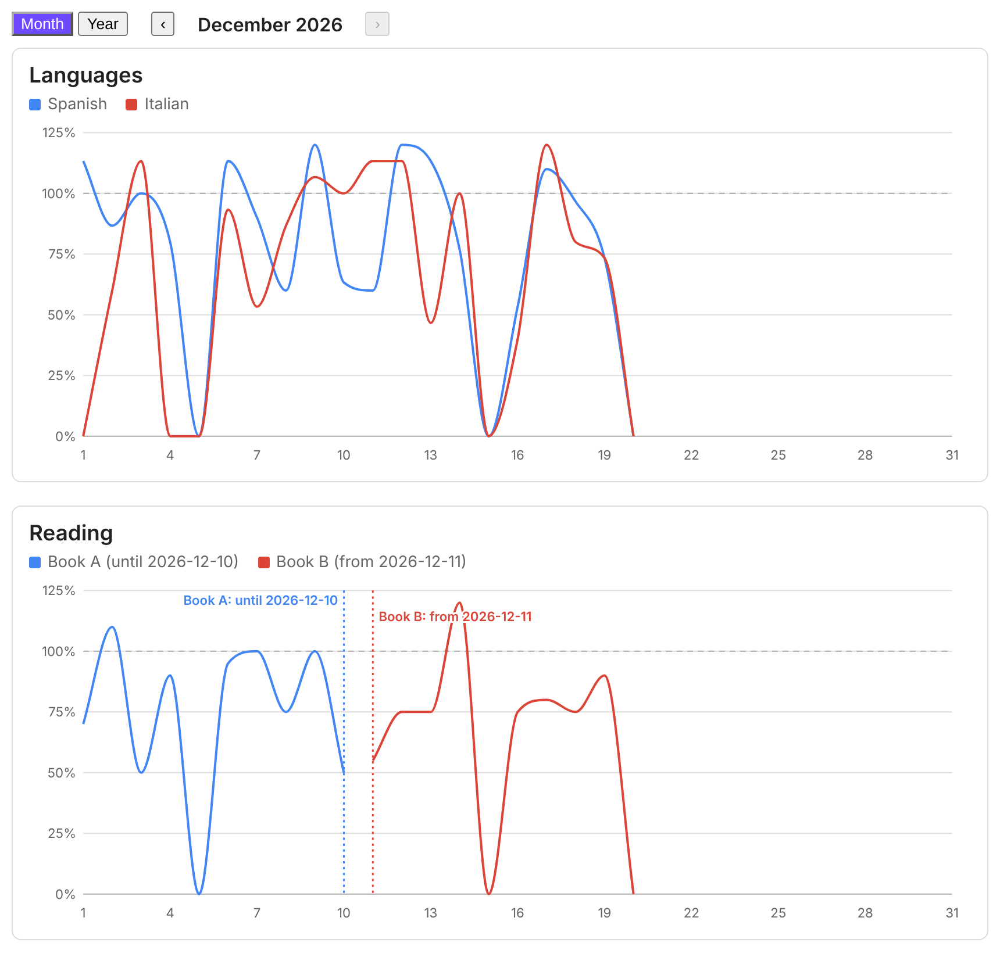
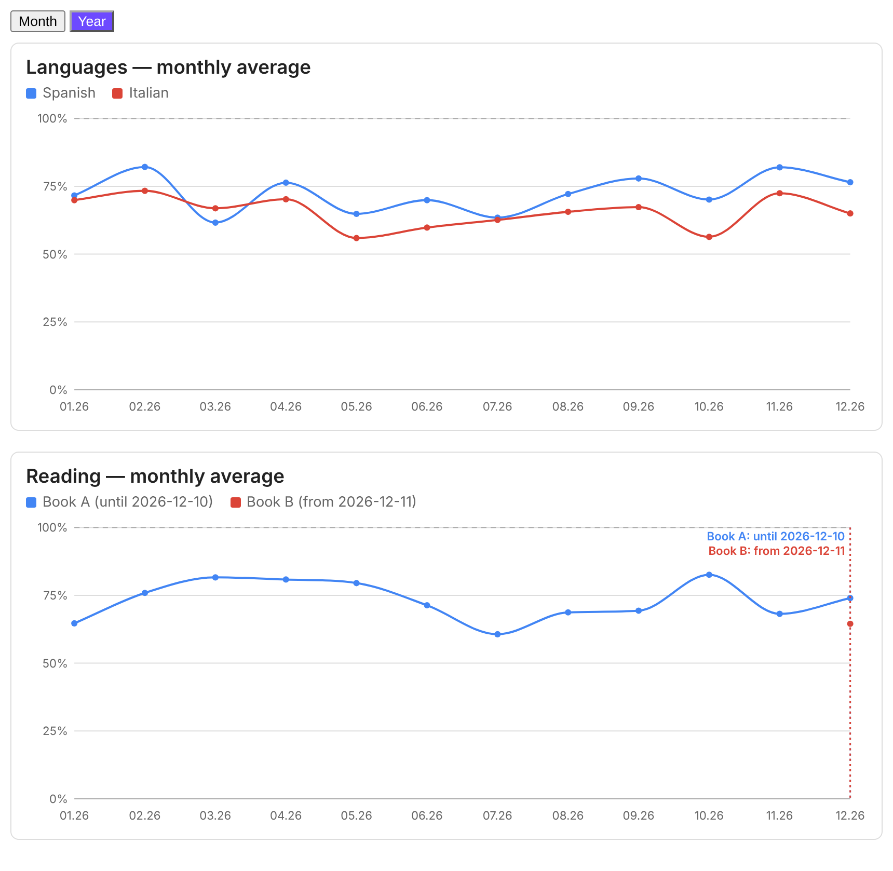

# Habit Charts

[English](README.md) · [Українська](README.uk.md) · **Deutsch** · [Magyar](README.hu.md)

Habit Charts zeichnet den Fortschritt deiner täglichen Gewohnheiten als Liniendiagramme, in Prozent eines Tagesziels.
Die Daten stammen aus dem Frontmatter deiner Tagesnotizen. Es ist ein schlichtes Obsidian-Plugin: keine
Abhängigkeiten, kein Netzwerk, und aus deinen Notizen wird niemals Code ausgeführt. Gelesen wird nur eine kleine
YAML-Konfiguration.





## Funktionen

- Eine Linie pro Gewohnheit, in Prozent ihres Tagesziels (Minuten ÷ Ziel × 100, zwei Nachkommastellen). Werte über 100 % sind erlaubt.
- Umschalter **Monat | Jahr**. Die Monatsansicht zeigt einen Kalendermonat, mit den Schaltflächen ‹ › zum Wechseln
  zwischen den Monaten. Die Jahresansicht zeigt den Monatsdurchschnitt der letzten 12 Monate.
- Tooltips beim Darüberfahren mit Minuten, Ziel und Prozentwert.
- Wechsel zu einer neuen Gewohnheit ohne Verlust der Historie: Gib jeder Gewohnheit ihre eigenen Daten (`from` / `to`).
  Eine gestrichelte Markierung mit Beschriftung wie „Buch A: bis 10.12.2026" und „Buch B: ab 11.12.2026" zeigt, wo
  die eine endete und die nächste begann. Tage außerhalb der Laufzeit einer Gewohnheit bleiben leer: Sie werden nicht
  gezeichnet und zählen nicht in Durchschnitten.
- Oberfläche auf Englisch, Deutsch, Ungarisch und Ukrainisch.
- Die Diagramme sind schlichtes SVG und folgen deinem Obsidian-Theme.

## Installation

In Obsidian: Einstellungen → Community-Plugins → Durchsuchen → **Habit Charts** suchen → Installieren → Aktivieren.

Manuell: Lade `main.js`, `manifest.json` und `styles.css` aus dem neuesten Release herunter, lege sie in
`<dein Vault>/.obsidian/plugins/habit-charts/` ab und aktiviere das Plugin unter Einstellungen → Community-Plugins.

## Deine Daten

Eine Notiz pro Tag, benannt `YYYY-MM-DD.md`, mit numerischen Frontmatter-Feldern (Minuten):

```yaml
---
tags: [daily]
hc_spanish: 30
hc_italian: 10
---
```

Eine fehlende Notiz, ein fehlendes Feld oder ein nicht numerischer Wert zählt als 0 %.

Tipp: Um die Felder des Plugins von denen anderer Plugins zu trennen, gib ihnen ein gemeinsames Präfix wie `hc_` und
setze `prefix: hc_` in der Konfiguration. Das Plugin liest nur die Felder, die in der Konfiguration aufgeführt sind.

## Verwendung

Füge einer beliebigen Notiz einen Codeblock mit der Sprache `habits` hinzu:

````
```habits
folder: 100 Calendar/Daily
prefix: hc_
views: [month, year]
lang: de
groups:
  - title: Sprachen
    series:
      - { name: Spanisch, key: spanish, goal: 30 }
      - { name: Italienisch, key: italian, goal: 15 }
  - title: Lesen
    series:
      - { name: Buch A, key: book_a, goal: 20, to: "2026-12-10" }
      - { name: Buch B, key: book_b, goal: 20, from: "2026-12-11" }
```
````

Ein ausführlicheres Beispiel steht in [examples/dashboard.md](examples/dashboard.md). Die Diagramme aktualisieren sich,
wenn sich deine Notizen ändern.

## Konfiguration

| Schlüssel | Bedeutung |
| --- | --- |
| `folder` | Ordner der Tagesnotizen. Ohne Angabe wird der gesamte Vault durchsucht. |
| `dateFormat` | Datumsformat der Notiznamen, Standard `YYYY-MM-DD`. |
| `prefix` | Optional: Präfix aller Frontmatter-Felder, zum Beispiel `hc_` (`key: spanish` liest `hc_spanish`). |
| `lang` | `en`, `de`, `hu` oder `uk`. Ohne Angabe (oder mit `auto`) wird die Obsidian-Sprache verwendet, bei nicht unterstützter Sprache Englisch. |
| `views` | `[month, year]` oder nur eine davon. Bei beiden erscheint ein Umschalter Monat / Jahr. |
| `month` | Optional `YYYY-MM`: der standardmäßig angezeigte Monat. Sonst der aktuelle Monat. |
| `months` | Anzahl der Monate in der Jahresansicht, Standard 12. |
| `smooth` | `false` schaltet die Glättung der Linien aus. |
| `groups` | Liste der Diagramme, jeweils mit `title` und einer Liste `series`. |
| `series` | `{ name, key, goal, color?, from?, to? }`. `goal` sind Minuten pro Tag. `from` und `to` sind der erste und der letzte Tag der Gewohnheit (`YYYY-MM-DD`). |

Eine Gewohnheit, die im angezeigten Zeitraum nicht existiert (zum Beispiel Buch B im November), wird gar nicht angezeigt.

Alternativ lässt sich eine durchgehende Linie mit Übergabe über `periods` schreiben:

```yaml
- periods:
    - { to: "2026-12-10", name: Buch A, key: book_a, goal: 20 }
    - { from: "2026-12-11", name: Buch B, key: book_b, goal: 20 }
```

## Datenschutz und Offenlegung

- Keine Netzwerkanfragen, keine Telemetrie, keine Werbung, kein Konto nötig.
- Das Plugin liest nur das Frontmatter von Notizen in deinem Vault, über den Metadaten-Cache von Obsidian. Es schreibt
  nie in deine Notizen und führt nie Code aus, der darin steht.

## Entwicklung

Das Plugin ist schlichtes JavaScript ohne Build-Schritt: `main.js`, `styles.css` und `manifest.json` sind das Plugin.
Für eine neue Version setze `version` in `manifest.json`, committe und pushe dann einen Tag, der genau dieser Version
entspricht (zum Beispiel `git tag 0.3.1 && git push origin 0.3.1`). Der Workflow in `.github/workflows/release.yml`
erstellt das GitHub-Release mit den drei Dateien und signiert sie mit GitHub Artifact Attestations.

Eine heruntergeladene Datei prüfst du mit: `gh attestation verify main.js -R kavodsky/habit-charts`.

## Lizenz

[MIT](LICENSE)
