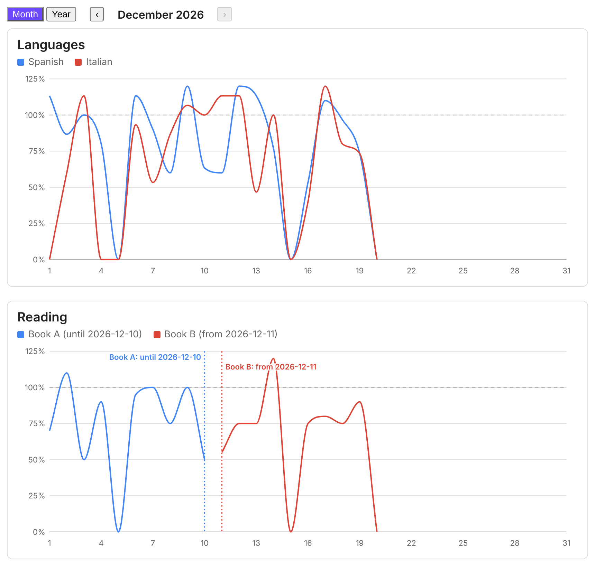
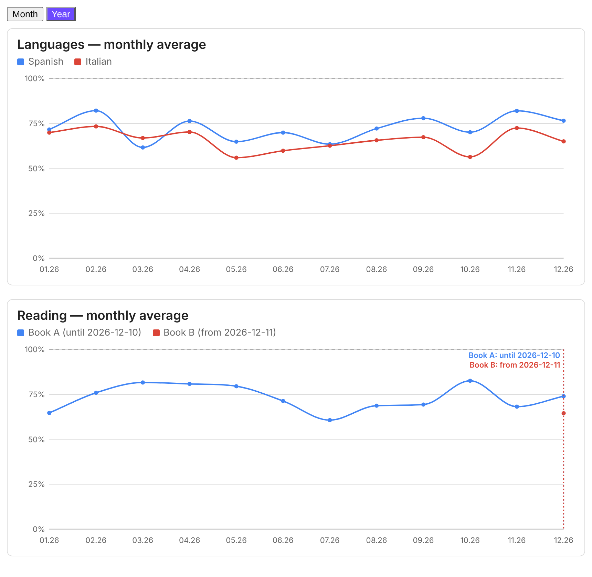

# Habit Charts

[English](README.md) · [Українська](README.uk.md) · [Deutsch](README.de.md) · **Magyar**

A Habit Charts vonaldiagramként rajzolja ki a napi szokásaid előrehaladását, a napi cél százalékában. Az adatok a
napi jegyzeteid frontmatter részéből származnak. Egyszerű Obsidian-bővítmény: nincsenek függőségei, nem használ
hálózatot, és a jegyzeteidből soha nem futtat kódot. Csak egy kis YAML-konfigurációt olvas.





## Funkciók

- Szokásonként egy vonal, a napi cél százalékában (perc ÷ cél × 100, két tizedesjegy). A 100% feletti érték megengedett.
- **Hónap | Év** kapcsoló. A havi nézet egy naptári hónapot mutat, a ‹ › gombokkal lehet hónapot váltani. Az éves nézet
  az utolsó 12 hónap havi átlagát mutatja.
- Egérrel fölé víve gyorsinfó jelenik meg a percekkel, a céllal és a százalékkal.
- Átváltás új szokásra az előzmények elvesztése nélkül: add meg minden szokás saját dátumait (`from` / `to`). Egy
  szaggatott jelölő felirattal, például „Könyv A: vége: 2026. 12. 10." és „Könyv B: kezdete: 2026. 12. 11.", mutatja,
  hol ért véget az egyik és hol kezdődött a másik. A szokás élettartamán kívüli napok üresek maradnak: nem rajzolódnak
  ki, és nem számítanak bele az átlagokba.
- A felület angol, német, magyar és ukrán nyelvű.
- A diagramok egyszerű SVG-k, és követik az Obsidian témát.

## Telepítés

Az Obsidianból: Settings → Community plugins → Browse → keresd a **Habit Charts** nevet → Install → Enable.

Kézzel: töltsd le a `main.js`, `manifest.json` és `styles.css` fájlokat a legújabb kiadásból, másold őket a
`<a te vaultod>/.obsidian/plugins/habit-charts/` mappába, majd kapcsold be a bővítményt a Settings → Community plugins
alatt.

## Az adataid

Naponta egy jegyzet, `YYYY-MM-DD.md` néven, numerikus frontmatter mezőkkel (percek):

```yaml
---
tags: [daily]
hc_spanish: 30
hc_italian: 10
---
```

A hiányzó jegyzet, a hiányzó mező és a nem szám érték 0%-nak számít.

Tipp: hogy a bővítmény mezői elkülönüljenek más bővítmények mezőitől, adj nekik közös előtagot, például `hc_`-t, és
állítsd be a konfigurációban: `prefix: hc_`. A bővítmény csak a konfigurációban felsorolt mezőket olvassa.

## Használat

Adj hozzá egy `habits` nyelvű kódblokkot bármelyik jegyzethez:

````
```habits
folder: 100 Calendar/Daily
prefix: hc_
views: [month, year]
lang: hu
groups:
  - title: Nyelvek
    series:
      - { name: Spanyol, key: spanish, goal: 30 }
      - { name: Olasz, key: italian, goal: 15 }
  - title: Olvasás
    series:
      - { name: Könyv A, key: book_a, goal: 20, to: "2026-12-10" }
      - { name: Könyv B, key: book_b, goal: 20, from: "2026-12-11" }
```
````

Egy hosszabb példa az [examples/dashboard.md](examples/dashboard.md) fájlban található. A diagramok frissülnek, ha a
jegyzeteid megváltoznak.

## Konfiguráció

| Kulcs | Jelentés |
| --- | --- |
| `folder` | A napi jegyzetek mappája. Nélküle az egész vaultban keres. |
| `dateFormat` | A jegyzetnevek dátumformátuma, alapértelmezés: `YYYY-MM-DD`. |
| `prefix` | Opcionális: az összes frontmatter mező előtagja, például `hc_` (a `key: spanish` a `hc_spanish` mezőt olvassa). |
| `lang` | `en`, `de`, `hu` vagy `uk`. Nélküle (vagy `auto` esetén) az Obsidian nyelve érvényes, ha ez nem támogatott, akkor az angol. |
| `views` | `[month, year]`, vagy csak az egyik. Ha mindkettő szerepel, megjelenik a Hónap / Év kapcsoló. |
| `month` | Opcionális `YYYY-MM`: az alapértelmezetten megjelenő hónap. Egyébként az aktuális hónap. |
| `months` | A hónapok száma az éves nézetben, alapértelmezés: 12. |
| `smooth` | A `false` kikapcsolja a vonalak simítását. |
| `groups` | A diagramok listája, mindegyik `title` mezővel és `series` listával. |
| `series` | `{ name, key, goal, color?, from?, to? }`. A `goal` perc naponta. A `from` és a `to` a szokás első és utolsó napja (`YYYY-MM-DD`). |

Az a szokás, amely nem létezik a megjelenített időszakban (például a Könyv B novemberben), egyáltalán nem jelenik meg.

Egy folytonos, átadással tarkított vonalat a `periods` kulccsal is meg lehet adni:

```yaml
- periods:
    - { to: "2026-12-10", name: Könyv A, key: book_a, goal: 20 }
    - { from: "2026-12-11", name: Könyv B, key: book_b, goal: 20 }
```

## Adatvédelem és közzététel

- Nincs hálózati kérés, telemetria, hirdetés, és fiók sem szükséges.
- A bővítmény csak a vaultodban lévő jegyzetek frontmatter részét olvassa, az Obsidian metaadat-gyorsítótárán
  keresztül. Soha nem ír a jegyzeteidbe, és soha nem futtat bennük talált kódot.

## Fejlesztés

A bővítmény egyszerű JavaScript, build lépés nélkül: a `main.js`, a `styles.css` és a `manifest.json` maga a
bővítmény. Új verzió kiadásához állítsd át a `version` értékét a `manifest.json` fájlban, commitold, majd pusholj egy
pontosan ezzel a verzióval egyező címkét (például `git tag 0.3.1 && git push origin 0.3.1`). A
`.github/workflows/release.yml` workflow létrehozza a GitHub-kiadást a három fájllal, és GitHub artifact
attestation-nel aláírja őket.

Letöltött fájlt így ellenőrizhetsz: `gh attestation verify main.js -R kavodsky/habit-charts`.

## Licenc

[MIT](LICENSE)
