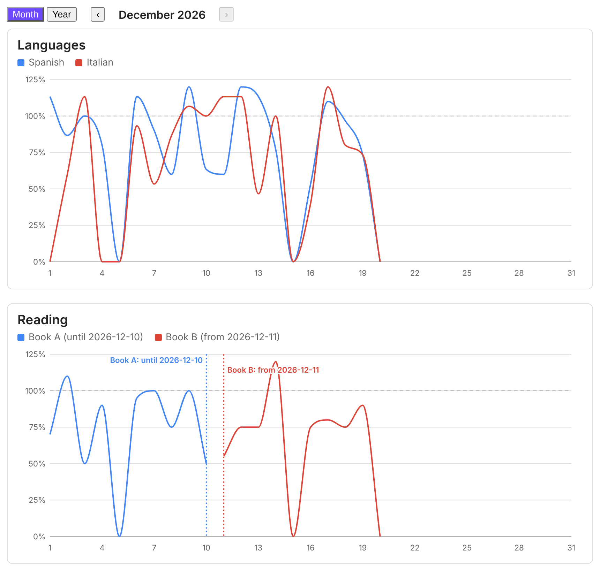
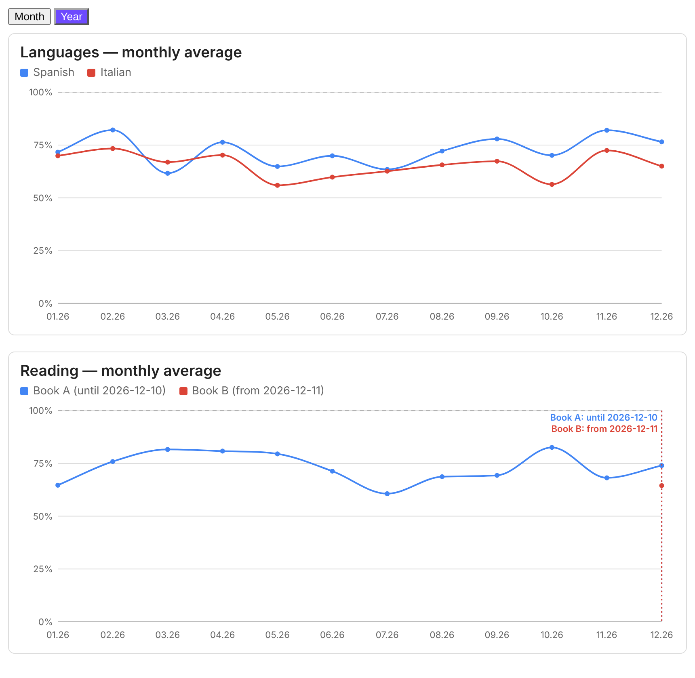

# Habit Charts

**English** · [Українська](README.uk.md) · [Deutsch](README.de.md) · [Magyar](README.hu.md)

Habit Charts draws your daily habit progress as line charts, in percent of a daily goal. The data comes from the
frontmatter of your daily notes. It is a plain Obsidian plugin: no dependencies, no network, and no code is ever
executed from your notes. Only a small YAML configuration is read.





## Features

- One line per habit, in percent of its daily goal (minutes ÷ goal × 100, two decimals). Values above 100% are allowed.
- **Month | Year** switch. The month view shows one calendar month with ‹ › buttons to move between months.
  The year view shows the monthly average for the last 12 months.
- Hover tooltips with minutes, goal and percentage.
- Switch to a new habit without losing history: give each habit its own dates (`from` / `to`). A dashed marker with
  a label such as "Book A: until 2026-12-10" and "Book B: from 2026-12-11" shows where one ended and the next began.
  Days outside the life of a habit stay empty: they are not drawn and do not count in averages.
- Interface in English, German, Hungarian and Ukrainian.
- Charts are plain SVG and follow your Obsidian theme.

## Installation

From Obsidian: Settings → Community plugins → Browse → search for **Habit Charts** → Install → Enable.

Manually: download `main.js`, `manifest.json` and `styles.css` from the latest release, put them into
`<your vault>/.obsidian/plugins/habit-charts/`, then enable the plugin under Settings → Community plugins.

## Your data

One note per day, named `YYYY-MM-DD.md`, with numeric frontmatter fields (minutes):

```yaml
---
tags: [daily]
hc_spanish: 30
hc_italian: 10
---
```

A missing note, a missing field or a non-numeric value counts as 0%.

Tip: to keep the plugin's fields apart from the fields of other plugins, give them a common prefix such as `hc_`
and set `prefix: hc_` in the configuration. The plugin reads only the fields listed in the configuration.

## Usage

Add a code block with the language `habits` to any note:

````
```habits
folder: 100 Calendar/Daily
prefix: hc_
views: [month, year]
groups:
  - title: Languages
    series:
      - { name: Spanish, key: spanish, goal: 30 }
      - { name: Italian, key: italian, goal: 15 }
  - title: Reading
    series:
      - { name: Book A, key: book_a, goal: 20, to: "2026-12-10" }
      - { name: Book B, key: book_b, goal: 20, from: "2026-12-11" }
```
````

A longer example is in [examples/dashboard.md](examples/dashboard.md). The charts update when your notes change.

## Configuration

| Key | Meaning |
| --- | --- |
| `folder` | Folder of the daily notes. Without it the whole vault is searched. |
| `dateFormat` | Date format of the note names, default `YYYY-MM-DD`. |
| `prefix` | Optional prefix of all frontmatter fields, for example `hc_` (`key: spanish` reads `hc_spanish`). |
| `lang` | `en`, `de`, `hu` or `uk`. Without it (or with `auto`) the Obsidian language is used, and English if that language is not supported. |
| `views` | `[month, year]`, or only one of them. With both, a Month / Year switch appears. |
| `month` | Optional `YYYY-MM`: the month shown by default. Otherwise the current month. |
| `months` | Number of months in the year view, default 12. |
| `smooth` | `false` turns off line smoothing. |
| `groups` | List of charts, each with a `title` and a list of `series`. |
| `series` | `{ name, key, goal, color?, from?, to? }`. `goal` is minutes per day. `from` and `to` are the first and last day of the habit (`YYYY-MM-DD`). |

A habit that does not exist in the period being shown (for example Book B in November) is not shown at all.

Alternatively, one continuous line with a handover can be written with `periods`:

```yaml
- periods:
    - { to: "2026-12-10", name: Book A, key: book_a, goal: 20 }
    - { from: "2026-12-11", name: Book B, key: book_b, goal: 20 }
```

## Privacy and disclosures

- No network requests, no telemetry, no ads, no account needed.
- The plugin reads only the frontmatter of notes inside your vault, through Obsidian's metadata cache. It never
  writes to your notes and never runs code found in them.

## Development

The plugin is plain JavaScript with no build step: `main.js`, `styles.css` and `manifest.json` are the plugin.
To release a new version, set `version` in `manifest.json`, create a GitHub release whose tag is exactly that
version and attach the three files.

## License

[MIT](LICENSE)
