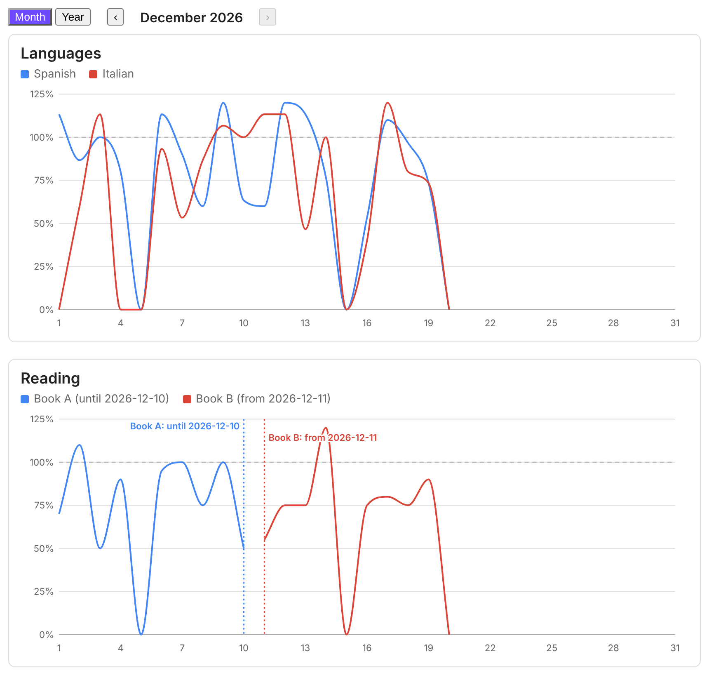
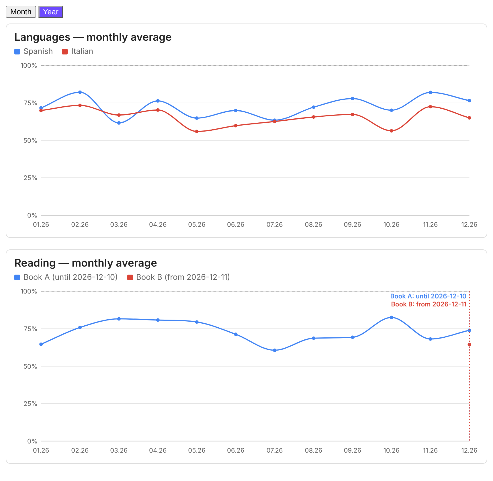

# Habit Charts

[English](README.md) · **Українська** · [Deutsch](README.de.md) · [Magyar](README.hu.md)

Habit Charts малює прогрес ваших щоденних звичок лінійними графіками у відсотках від денної цілі. Дані беруться з
frontmatter щоденних нотаток. Це звичайний плагін Obsidian: без залежностей, без мережі, і код з ваших нотаток
ніколи не виконується. Читається лише невеликий YAML-конфіг.





## Можливості

- Одна лінія на звичку, у відсотках від її денної цілі (хвилини ÷ ціль × 100, два знаки після коми). Понад 100% дозволено.
- Перемикач **Місяць | Рік**. Місячний вигляд показує один календарний місяць із кнопками ‹ › для переходу між
  місяцями. Річний вигляд показує середнє за місяць за останні 12 місяців.
- Підказки при наведенні: хвилини, ціль і відсоток.
- Перехід на нову звичку без втрати історії: кожній звичці задайте її власні дати (`from` / `to`). Пунктирна позначка
  з підписом на кшталт «Книга A: до 10.12.2026» і «Книга B: з 11.12.2026» показує, де одна закінчилась, а друга почалась.
  Дні поза життям звички лишаються порожніми: вони не малюються і не входять у середнє.
- Інтерфейс англійською, німецькою, угорською та українською.
- Графіки — звичайний SVG, вони слідують темі Obsidian.

## Встановлення

З Obsidian: Settings → Community plugins → Browse → знайдіть **Habit Charts** → Install → Enable.

Вручну: завантажте `main.js`, `manifest.json` і `styles.css` з останнього релізу, покладіть їх у
`<ваше сховище>/.obsidian/plugins/habit-charts/` і увімкніть плагін у Settings → Community plugins.

## Ваші дані

Одна нотатка на день з назвою `YYYY-MM-DD.md` і числовими полями frontmatter (хвилини):

```yaml
---
tags: [daily]
hc_spanish: 30
hc_italian: 10
---
```

Відсутня нотатка, відсутнє поле або нечислове значення = 0%.

Порада: щоб відокремити поля плагіна від полів інших плагінів, дайте їм спільний префікс, наприклад `hc_`, і задайте
`prefix: hc_` у конфігу. Плагін читає лише ті поля, що перелічені в конфігу.

## Використання

Додайте в будь-яку нотатку блок коду з мовою `habits`:

````
```habits
folder: 100 Calendar/Daily
prefix: hc_
views: [month, year]
lang: uk
groups:
  - title: Мови
    series:
      - { name: Іспанська, key: spanish, goal: 30 }
      - { name: Італійська, key: italian, goal: 15 }
  - title: Читання
    series:
      - { name: Книга A, key: book_a, goal: 20, to: "2026-12-10" }
      - { name: Книга B, key: book_b, goal: 20, from: "2026-12-11" }
```
````

Довший приклад є в [examples/dashboard.md](examples/dashboard.md). Графіки оновлюються, коли змінюються нотатки.

## Конфігурація

| Ключ | Значення |
| --- | --- |
| `folder` | Папка щоденних нотаток. Без неї шукається по всьому сховищу. |
| `dateFormat` | Формат дати в назвах нотаток, за замовчуванням `YYYY-MM-DD`. |
| `prefix` | Необов'язково: префікс усіх полів frontmatter, наприклад `hc_` (`key: spanish` читає `hc_spanish`). |
| `lang` | `en`, `de`, `hu` або `uk`. Без нього (або з `auto`) береться мова Obsidian, а якщо її не підтримано, то англійська. |
| `views` | `[month, year]` або лише один із них. Якщо обидва, з'являється перемикач Місяць / Рік. |
| `month` | Необов'язково `YYYY-MM`: місяць, що відкривається за замовчуванням. Інакше поточний. |
| `months` | Кількість місяців у річному вигляді, за замовчуванням 12. |
| `smooth` | `false` вимикає згладжування ліній. |
| `groups` | Список графіків, кожен з `title` і списком `series`. |
| `series` | `{ name, key, goal, color?, from?, to? }`. `goal` — хвилин на день. `from` і `to` — перший і останній день звички (`YYYY-MM-DD`). |

Звичка, якої немає в показаному періоді (наприклад, Книга B у листопаді), не показується взагалі.

Одну неперервну лінію зі зміною можна записати й через `periods`:

```yaml
- periods:
    - { to: "2026-12-10", name: Книга A, key: book_a, goal: 20 }
    - { from: "2026-12-11", name: Книга B, key: book_b, goal: 20 }
```

## Приватність і розкриття інформації

- Жодних мережевих запитів, телеметрії, реклами чи облікових записів.
- Плагін читає лише frontmatter нотаток у вашому сховищі через кеш метаданих Obsidian. Він ніколи не пише у ваші
  нотатки і не виконує код, знайдений у них.

## Розробка

Плагін — звичайний JavaScript без етапу збірки: плагіном є `main.js`, `styles.css` і `manifest.json`. Щоб випустити
нову версію, змініть `version` у `manifest.json`, закомітьте, а тоді запуште тег, що точно дорівнює цій версії
(наприклад, `git tag 0.3.1 && git push origin 0.3.1`). Workflow у `.github/workflows/release.yml` створює реліз на
GitHub із трьома файлами й підписує їх атестаціями артефактів GitHub.

Завантажений файл можна перевірити так: `gh attestation verify main.js -R kavodsky/habit-charts`.

## Ліцензія

[MIT](LICENSE)
